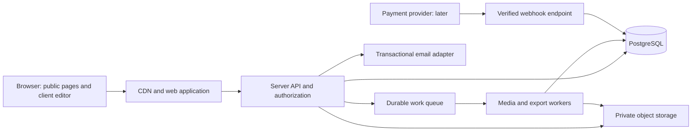

# Invitation Maker ? Development Roadmap

Updated: 2026-11-13 (Asia/Calcutta). This is the maintained phased blueprint. Current implementation and remaining release gates are recorded in [status](../development/status.md); root [PLAN.md](../../PLAN.md) controls authorized work. Building a local milestone is not approval for public deployment.

## 1. Product outcome and current baseline

Build a mobile-friendly platform for invitation discovery, guided personalization, durable private saving and accurate downloads. The local studio and server account foundation are implemented. Full canvas editing, verified public accounts, private media/jobs, admin publishing and later event/commercial capabilities remain staged work. The launch catalog target is 50 distinct approved concepts, including 29 photo-ready and 21 non-photo across 12 occasions; current concept variants still require artwork/rights approval.

Canonical specifications: [requirements](requirements.md), [design](design.md), [architecture](../architecture/overview.md), [database](../architecture/database.md), [API](../architecture/api.md) and [authentication](../architecture/authentication.md). Historical mockup/audit snapshots were removed after full backup during the repository cleanup; they are not runtime dependencies.

## 2. Scope, priorities and release boundaries

### Priority definitions

- **P0 — reliable launch:** required to complete the main create/save/export journey safely and professionally.
- **P1 — complete editing and sharing:** important expansion after launch quality is proven.
- **P2 — commercial and regional expansion:** independently approved capabilities requiring additional operational or business decisions.
- **P3 — experimental/platform expansion:** validate demand and feasibility before committing.

These definitions refine the older docs/product/roadmap.md priorities. In particular, retaining all 50 designs as the public launch target is a recommendation for approval; the existing documents vary on when the complete catalog ships.

### Proposed releases

| Release | Included phases | User-visible outcome |
|---|---|---|
| Blueprint approval | 0–1 | Approved scope, flows, visual direction and acceptance criteria; no product implementation. |
| Technical feasibility | 2 | After authorization, prove schema, editor engine and exports before broad development. |
| Private alpha | 3–5, with export proofs from 2 | Accounts, catalog, projects and guided editing on representative templates; explicitly not a public launch. |
| Public MVP | 6–7 | Full approved launch catalog, save/reopen, photo workflow, PNG/PDF downloads, admin publishing, support and monitored operations. |
| Editor expansion | 8 | Advanced Editor and recoverable version history. |
| Hosted-event expansion | 9A–9B | Revocable invitation pages, then optional RSVP/guest management. |
| Commercial expansion | 10 | Approved paid products and trustworthy billing operations. |
| Growth releases | 11A–11D | Selected languages, professional workflows, AI assistance and other validated additions. |

**Public MVP excludes** full Advanced Editor, RSVP collection, payments/subscriptions, AI generation, collaboration, marketplace and video. Sharing links remain a proposed post-MVP release; users can manually share downloaded files at MVP. These boundaries are explicit scope choices for review, not assumptions that all proposed features are mandatory.

### Feature coverage and priority matrix

| ID | Capability and proposed functionality | Priority | Phase | Acceptance evidence |
|---|---|---|---|---|
| F01 | Responsive home, occasion pages, how-it-works, FAQs, help/contact, genuine trust information and footer/legal links | P0 | 1, 4, 7 | Mobile/desktop navigation, readable content, working help paths |
| F02 | Gallery search; occasion/style/photo/orientation/palette filters; sort; clear-all; URL-persisted state; useful empty states | P0 | 4 | Filter combinations, back navigation and counts match actual metadata |
| F03 | Dedicated template detail page: full preview, variants, dimensions, editable fields, photo slots and limitations | P0 | 4 | Clear selection and accurate metadata; keyboard-accessible preview |
| F04 | Email/password and Google sign-in, verification/recovery, secure sessions, account linking and logout | P0 | 3 | Success/failure/recovery/session and account-linking tests |
| F05 | Guest trial and sign-in handoff that preserves edits without creating publicly accessible drafts | P0 | 4–5 | Trial → login → private project retains supported state |
| F06 | Dashboard; event projects with multiple cards; create/rename/duplicate/archive/delete/reopen; search/sort | P0 | 4–5 | Correct owner-only CRUD and shared-detail behavior |
| F07 | Guided Simple Editor: occasion-specific fields, names, messages, date/time/venue/contact, live preview and review step | P0 | 5 | Complete main journey on photo and non-photo templates |
| F08 | Local/server image validation, rotation/orientation correction, crop/reposition/replace/remove and progress/errors | P0 | 3, 5 | Bounded image pipeline; crops persist and export identically |
| F09 | Supported palette/font choices, optional sections, text-fit warnings, layout constraints and readable presets | P0 | 5 | Every shown control works for the selected template |
| F10 | Autosave, explicit save status, reopen, revisions, stale-tab conflicts, reconnect recovery and unsaved-change guard | P0 | 5 | Refresh/reopen, offline retry and conflict tests without silent overwrite |
| F11 | PNG/PDF export presets, final preview, job progress/retry, signed download and export history | P0 | 6 | Same saved revision and expected dimensions/fonts/assets |
| F12 | Versioned admin template upload, metadata, schema/license checks, preview/export proof, publish/unpublish and audit | P0 | 6 | New valid template visible without an application code change |
| F13 | Approved 50-template launch catalog; distinct compositions, 12 occasions, 29/21 photo mix | P0 proposal | 4–6 | Catalog manifest, license records and export proofs for all 50 |
| F14 | Profile, active-session controls, storage usage, account/data deletion and data export request workflow | P0 | 3, 7 | User can request and track appropriate data controls |
| F15 | Accessible responsive controls, loading/error/empty states, form recovery and reduced motion throughout | P0 | 1–7 | Automated checks plus keyboard, screen-reader and device evidence |
| F16 | SEO for public marketing/catalog, metadata/social previews, canonical URLs, sitemap and image optimization | P0 | 4, 7 | Public pages indexable; private pages/data excluded |
| F17 | Support workflow, redacted diagnostics, privacy-aware analytics, errors/latency/queue dashboards and alerts | P0 | 3, 7 | Instrumented journey, useful alerts and support escalation |
| F18 | Select/move/resize/rotate, layers, align/distribute/snap, typography, opacity, lock/group, undo/redo, zoom | P1 | 8 | Pointer/keyboard/property-panel operations and roundtrip tests |
| F19 | Version history, named checkpoints, restore-as-new-revision and copy/duplicate safeguards | P1 | 8 | Restore retains newer history and respects owner checks |
| F20 | Favorites and recently used designs; saved project presets and reusable event details | P1 | 8 | Per-user persistence; explicit propagation/override controls |
| F21 | Published invitation snapshot, revoke/rotate/expire links, QR, native/WhatsApp share intent, calendar and maps links | P1 | 9A | Share lifecycle, privacy and published-version tests |
| F22 | Host-enabled RSVP, deadlines, party limits, response changes, host dashboard, CSV and notification controls | P2 | 9B | Abuse, duplicate, capacity, privacy and CSV safety tests |
| F23 | Clear premium rights, hosted checkout, receipts/history, entitlements, refunds/support and reconciliation | P2 | 10 | Webhook/replay/failure/refund tests and audited transactions |
| F24 | Interface translation and invitation languages, beginning with approved languages; Unicode/font shaping | P2 | 11A | Native-language review and preview/export parity |
| F25 | Event bundles, brand presets, bulk export and professional reuse workflows | P2 | 11B | Correct inheritance, bounded batches and access controls |
| F26 | Opt-in wording assistance/translation, review-before-apply and usage/cost caps | P3 | 11C | Privacy, safety, language quality and provider-failure evaluation |
| F27 | Real-time collaboration, designer marketplace, video invitations, AI artwork/layout generation | P3 | 11D | Separate discovery, rights, moderation and feasibility gates |
| F28 | PWA/installability and stronger offline draft editing | P3 | 11D | Device/storage/security study and explicit offline sync semantics |

Application dark mode is an optional polish item after contrast testing; invitation palettes remain independent. Avoid adding decorative effects, testimonials, ratings, premium badges or business claims without actual product support and evidence.

## 3. UI/UX blueprint

### Information architecture

Public: Home → Occasions/Gallery → Template detail → Guest trial/Editor; How it works, Help/FAQ, Contact, Privacy, Terms, accessibility information and licensing/usage information. Pricing/refunds appear only when a commercial offer is enabled.

Authenticated: My Projects → Event project → Invitation editor → Review/download; Account/profile, sessions, data controls and export history. Later: Favorites, history, sharing/RSVP and billing.

Admin: Catalog and version review → Sample/exports validation → Publish; user-account moderation, asset/license records, audit and operational error views. Admin access is separately authorized and does not grant routine reading of private user content.

### Main user journey

1. Discover by occasion and visual style without signing in.
2. Inspect a large template preview and its actual editable capabilities.
3. Personalize example fields; upload only when the template supports photos.
4. Authenticate when durable saving is needed, retaining trial work.
5. Complete structured event details, photo crop and supported visual options.
6. See clear saving/saved/offline/conflict status and a final content-fit check.
7. Select an approved output preset, confirm the saved revision and generate/download.
8. Reopen or duplicate later; explicitly publish/share only after hosted sharing is released.

### Visual design and component requirements

- Reconcile docs/product/design.md's proposed plum/coral/gold/ivory palette with the prototype; approve one UI token set. Template artwork retains its own palettes.
- Define semantic color tokens, type scale, spacing, grid, radii, elevations, icon style, focus/error/success/disabled states and content guidelines. Test contrast before approving color usage.
- Use a restrained sans-serif for application controls; licensed decorative fonts within invitation designs. Provide stable fallback/loading behavior.
- Shared components: buttons, inputs, date/time controls, selects/comboboxes, tabs, dialog/drawer, toast/status, skeleton, cards, pagination, upload/crop controls, confirmation and progress states.
- Gallery: attractive full-card previews, readable metadata, filter chips and reset, search suggestions only if useful, responsive thumbnails and lazy loading. No infinite scrolling as the only navigation mechanism.
- Desktop editor: form/tools alongside a fixed-aspect preview. Tablet: collapsible panels. Mobile: stable preview/edit tabs or sheet with persistent save/download access; keyboard must not cover important controls.
- Canvas controls must have property-panel and single-pointer alternatives to drag-only operations. Add shortcut help, visible selection and touch targets; target 44px controls where practical while meeting applicable WCAG criteria.
- Preserve all invitation text on mobile; scale or pan the preview rather than hiding messages. Expose event details as structured readable text outside the visual canvas when appropriate.
- Validate required fields inline, explain how to fix overflow, retain entered data after errors and distinguish missing uploads from unsupported features.
- Accessible dialog naming/focus, associated field labels, live save/error status, reduced motion, logical heading/focus order and accessible authentication are required. Target WCAG 2.2 AA across the product, including usable alternatives around canvas content. [WCAG 2.2](https://www.w3.org/TR/WCAG22/), [W3C dialog pattern](https://www.w3.org/WAI/ARIA/apg/patterns/dialog-modal/).

### Screen approval package

For every core screen, approve desktop and mobile states, not just a single happy-path screenshot: loading, empty, populated, validation error, permission denied, offline/retry and destructive-action confirmation where applicable. Include first-time and returning users, long names/venues, large text zoom, photo failure, interrupted login, stale draft and failed export.

## 4. Proposed technical architecture

### Initial deployment shape

Use a modular monolith for web/API plus independently running workers. Preserve module boundaries so a service can be extracted if measured requirements justify it; avoid starting with microservices.



The browser may upload directly through a narrow signed upload grant; the API/worker must confirm and validate before the asset becomes usable. Public catalog assets can use a CDN. Private originals and exports remain access-controlled. Public invitation derivatives, when introduced, have explicit publication/revocation rules.

### Stack recommendations, subject to architecture decision records

| Concern | Proposed direction | Decision/constraint |
|---|---|---|
| Web | Next.js App Router, React, strict TypeScript | Pin supported compatible versions at implementation; server-render public catalog, load editor client code on demand |
| Styling/UI | Tailwind with shared accessible primitives and tokens | Select a maintained component approach; audit accessibility/licenses |
| API | Next.js route handlers with separate domain/data-access modules | Keep /api/v1 contract; separate Fastify service only if deployment/load warrants it |
| Editor | Fabric.js or Konva behind a document adapter | Select by Phase 2 comparison; do not persist library objects as the application domain |
| Database | Managed PostgreSQL, migrations, typed data access | ORM/query builder chosen in Phase 2; constraints and atomic writes required |
| Assets | S3-compatible private storage and processed derivatives | Region, lifecycle, CORS, quotas and signed-URL policy approved before provision |
| Jobs | Durable managed queue or an approved Redis-backed queue | Export/media/email workers; retry, idempotency, timeouts and dead-letter handling |
| Auth | Maintained library or provider for email/password and Google | Recovery, linking, revocation, admin MFA and data location must be supported |
| Tests | Vitest/Testing Library, API/database integration, Playwright, axe and visual comparison | Real database/storage/queue integration in staging; controlled test data |
| Monitoring | Structured logs, error tracking, metrics and privacy-aware product events | Redact invitation text, photos, credentials, tokens and guest data |
| Hosting | Managed web runtime, managed database, container-capable workers | Confirm worker font/rendering support, execution limits, region and cost ceilings |

Next.js documentation recommends authorization near data access; route redirects alone are insufficient. Require role/ownership checks on every relevant read/write, including server actions, asset grants and worker job authorization. [Next.js authentication guidance](https://nextjs.org/docs/app/guides/authentication).

### Proposed workspace ownership

- `apps/web`: public pages, authenticated UI and initial API route handlers.
- A future worker application will own media processing, exports, email jobs and scheduled cleanup; create its directory when implemented.
- A separate API application is a future option only if selected by an ADR; no empty placeholder is maintained.
- Shared UI components currently live in apps/web/components; extract a UI package only when multiple applications need it.
- `packages/editor-core`: canonical document operations, bindings, commands, undo and roundtrip semantics.
- `packages/template-engine`: document-to-renderer adapters, validation and deterministic rendering/export support.
- Shared types and validation currently live with editor-core/database; create a general shared package only when a concrete consumer needs it.
- `packages/database`: schema, migrations and controlled data access.

### Canonical document and renderer contract

Persist an engine-independent, versioned document containing:

- Schema version, template-version reference, document dimensions, units, output presets, bleed and safe-area metadata.
- Stable layer IDs/types/order, text bindings, visibility/lock state, transforms and style overrides.
- Field values and constraints, optional sections, locale, date/time/timezone and explicit event-detail inheritance.
- Asset IDs and crop transforms, orientation, clipping/masks, background/decorations, font IDs/versions and palette references.
- Invitation revision and migration compatibility metadata. Do not persist expiring URLs as permanent asset identities.

Simple editing updates bound fields and approved options. Advanced editing applies commands/overrides without destroying bindings. Returning to Simple preserves advanced work; a reset/reflow command must be explicit, scoped and undoable. Unsupported newer documents open safely as read-only or with an upgrade path, not a silent destructive conversion.

Both editors and the worker render the same pinned document. Export records bind to an immutable document snapshot, revision, template version, renderer build and font/asset set. The user sees if the latest unsaved changes are not included. Konva and Fabric documentation support separating application state from rendering-specific objects; this is the basis for the adapter recommendation. [Konva serialization guidance](https://konvajs.org/docs/data_and_serialization/Best_Practices.html), [Fabric custom properties](https://www.fabricjs.com/docs/using-custom-properties/).

### Data-model changes to design before implementation

Keep existing entities but specify missing lifecycle and relational details:

| Domain | Required additions/refinements | Phase |
|---|---|---|
| Identity | Provider identities, session/revocation model, verification/recovery through chosen auth system, role audit | 2–3 |
| Projects | Ownership, explicit shared-field overrides, archive/trash/deletion lifecycle and safe duplication | 2–5 |
| Invitations | Atomic revision increments, canonical content schema, saved snapshots/checkpoints and locale/timezone | 2, 5, 8 |
| Catalog | Controlled occasion/style/format taxonomy, immutable versions, capability flags, license/provenance manifest | 2, 4, 6 |
| Assets | Pending/processing/ready/rejected states, upload expiry, type/dimension limits, ownership, derivative references and cleanup | 2–5 |
| Export jobs | Snapshot/revision, preset, renderer version, idempotency key, attempts, terminal state and expiry | 2, 6 |
| Sharing | Token hashes, snapshot publication, expiry/revocation, public derivative scope and cache invalidation | 9A |
| RSVP | Share/invitation scope, response identity/update policy, capacity, consent, deadline and retention | 9B |
| Billing | Provider-scoped unique IDs, webhook event ledger, order/payment/refund state, entitlements and reconciliation | 10 |
| Operations | Audit records, email delivery/outbox, deletion jobs and request/correlation IDs | 3 onward |

Define FKs, enums/checks, unique keys, indexed query paths, UTC timestamp types/defaults, nonnegative limits and deletion rules. Evaluate PostgreSQL row-level security as defense in depth, including role bypass and connection-context tests; it does not replace application authorization. [PostgreSQL row security](https://www.postgresql.org/docs/current/ddl-rowsecurity.html).

### API and asynchronous contracts

- Produce OpenAPI-compatible request/response schemas for /api/v1; stable error codes, bounded pagination and field validation.
- Use atomic expected-revision updates returning 409 on conflict; document replacement/patch semantics and immutable fields.
- Specify auth verification/recovery, project/card CRUD, upload-intent/confirmation, export jobs/status and template publishing before implementation.
- Later add share revoke/rotate/update, RSVP response/update/export and billing/refund contracts rather than inventing undocumented endpoints during coding.
- Export submit returns an asynchronous job reference with authorization-checked status/download access. Persist the job and enqueue request reliably, using a transactional outbox or equivalent recovery mechanism.
- Workers must tolerate duplicate delivery, retries and out-of-order status changes; make artifact writes and completion transitions idempotent. SQS standard queues explicitly permit duplicates and out-of-order delivery, illustrating why this requirement matters even with managed infrastructure. [SQS delivery semantics](https://docs.aws.amazon.com/AWSSimpleQueueService/latest/SQSDeveloperGuide/standard-queues.html).
- Set payload, image, document/layer, export pixel and concurrency limits. No arbitrary remote asset fetching by workers; restrict origins/keys to prevent server-side request forgery.
- Cache published catalog data deliberately; never use shared caches for user-specific responses. Revalidate publication changes and respect share revocation.

## 5. Phase-wise delivery roadmap

All work below is proposed. Each phase requires an approved task list before coding; later phases do not become authorized automatically when an earlier gate passes. Each implementation slice follows coder implementation → tester validation → reviewer approval → merge → staging smoke checks, as required by AGENTS.md.

### Phase 0 — Requirements reconciliation and release definition

**Objective:** establish one measurable product scope and remove contradictions before designs or implementation decisions harden.

**Scope/key functionalities:** define personas, complete user journeys, permissions, MVP/expansion boundaries and acceptance criteria. Decide launch catalog size/mix, initial language, supported dimensions/formats, guest save/export rules, sharing timing and free/paid boundaries. Define measurable success and abuse/storage constraints. Correct the documented screen inventory as an approved documentation task.

**Dependencies:** current specifications and review; product owner availability. No application build required.

**Deliverables:** reconciled PRD and feature matrix; prioritized backlog with IDs; catalog inventory/rights checklist; decision register; acceptance matrix; approved scope and initial resource/budget envelope.

**Testing requirements:** requirements traceability review; walk through photo/non-photo, multi-event, guest-to-user and admin scenarios; confirm every P0 requirement has objective acceptance criteria and error cases.

**Exit gate:** product owner approves release boundaries, unresolved blockers have named owners, and assumptions affecting implementation are resolved or explicitly deferred.

### Phase 1 — Product design, information architecture and usability specification

**Objective:** approve a consistent, accessible experience for every core screen and device class.

**Scope/key functionalities:** sitemap/navigation, brand tokens/components, gallery/detail, auth handoff, dashboard/project, guided editor, upload/crop, preview/download, admin publishing and account/support states. Design Advanced Editor and sharing concepts sufficiently to validate the document model, while keeping their build deferred.

**Dependencies:** Phase 0 scope and personas; representative licensed or clearly marked draft artwork.

**Deliverables:** desktop/mobile wireframes, high-fidelity screen specifications, clickable design prototype, component/state inventory, microcopy, content plan, accessibility checklist and approved photo/non-photo sample designs.

**Testing requirements:** moderated task walkthroughs with a proposed 5–8 representative participants, including mobile-first users and accessibility needs; keyboard/focus review, contrast/zoom review, long-content and failure-state review. Record issues rather than treating a small sample as statistical proof.

**Exit gate:** home/gallery, Simple Editor, Advanced Editor concept, mobile flow, project/admin flow and template direction approved; critical usability issues resolved before implementation.

### Phase 2 — Architecture decisions, canonical schema and export feasibility

**Objective:** retire the highest-risk technical unknowns before building the full platform. This phase includes coding spikes only after separate implementation authorization.

**Scope/key functionalities:** compare Fabric.js/Konva using identical fixtures; prove text editing, binding preservation, crop/transforms, serialization, mobile interaction and deterministic worker output. Evaluate headless-browser versus engine-native worker rendering. Decide auth, query/migration tooling, storage, queue, hosting and email. Define canonical schema, data model and API contracts.

**Dependencies:** Phases 0–1; approved output presets, representative fonts/photos and infrastructure constraints.

**Deliverables:** ADRs with comparison evidence and rejected alternatives; schema/validation specification; ERD and lifecycle/state diagrams; API specification; threat model; representative PNG/PDF proofs; capacity/cost model and version compatibility policy.

**Testing requirements:** photo/non-photo fixtures; long and empty fields; accents/Unicode and future-language feasibility; missing font/image; crop/orientation; mobile memory; save/load/mode roundtrip; DPI/bleed/output geometry; CORS; duplicate job/retry simulations. Compare visual output on the same snapshot in controlled environments.

**Exit gate:** selected stack and document format approved, no unresolved preview/export blocker, and explicit export tolerance/browser/preset matrix agreed. Spikes do not silently become production services.

### Phase 3 — Engineering foundation, identity and secure data platform

**Objective:** create a maintainable development/staging foundation with trustworthy identity and private-resource access.

**Scope/key functionalities:** Git repository/branch workflow, monorepo setup, strict TypeScript, shared validation/UI foundations, CI, environment/secrets handling, local/staging services, migrations, auth registration/login/Google/recovery/linking/logout, session controls, admin role/MFA, protected data access, audit logging, storage/queue adapters and health/telemetry foundations.

**Dependencies:** approved Phase 2 ADRs/contracts, service budget/region, credentials supplied through secrets management.

**Deliverables:** reproducible development setup; pinned dependency lockfile; CI checks; environment example with names only; baseline migrations; auth/API modules; staging environment; permission matrix tests; infrastructure and backup configuration documentation.

**Testing requirements:** build/lint/typecheck/unit gates; clean database and upgrade migrations; user A/B/guest/admin access matrix; OAuth cancellation/state/nonce/linking errors as applicable; reset-token expiry/reuse; session invalidation/CSRF; secrets/redaction; least-privilege storage and queue access; staging smoke checks.

**Exit gate:** a clean checkout runs documented checks and staging deployment; unauthorized private reads/writes fail; sensitive actions are audited; backups and restoration procedure exist for early staging use.

### Phase 4 — Public website, catalog and private project workspace

**Objective:** deliver discovery and organization with polished navigation before full editing.

**Scope/key functionalities:** home/occasion/gallery/detail pages, search/filter/sort/reset and URL state, public metadata/sitemap, help content, dashboard and multi-card projects, create/rename/duplicate/archive/delete, empty states, profile basics and guest-to-user trial handoff structure. Use capability metadata for photo/layout filtering rather than numeric CSS layout guesses.

**Dependencies:** design system and Phase 3 identity/data access; catalog schema and licensed assets. Content production can proceed alongside engineering after design approval.

**Deliverables:** responsive public/authenticated pages, project/catalog APIs, initial representative catalog for private alpha (proposed minimum one per occasion), content/metadata seeds and full-catalog production tracker. Reduced alpha inventory does not change the 50-design public launch proposal.

**Testing requirements:** filter combinations/counts, query/back/forward navigation, unpublished template exclusion, SEO metadata/canonical checks, owner-scoped project CRUD/duplication, shared-detail inheritance, empty/error states, mobile/keyboard/zoom and authentication return paths.

**Exit gate:** users can discover and select actual published templates and manage only their projects; catalog metadata is accurate and trial handoff has a documented state contract.

### Phase 5 — Simple Editor, media workflow and reliable persistence

**Objective:** complete the guided personalization journey without silent content loss.

**Scope/key functionalities:** structured occasion-specific forms; locale-aware event fields; live preview; capability-aware colors/fonts/optional sections; upload validation and crop/replace/remove; safe text-fit behavior; canonical document writes; autosave/manual save, reopen, local recovery, conflict resolution and save-status UX. Share common event details with explicit per-card overrides. Keep Advanced mode hidden or clearly unavailable until its gate passes.

**Dependencies:** Phase 2 schema/renderer proof, Phase 3 storage/auth, Phase 4 project/template selection. Local recovery must define expiry and cleanup on logout/shared devices.

**Deliverables:** complete Simple Editor and asset pipeline, revision-safe persistence APIs, guest handoff preserving all supported state, error/recovery UI, representative production template documents and editing regression fixtures.

**Testing requirements:** save/reopen retains text/theme/font/photo/crop; duplicate and shared-field overrides; stale-tab 409 and controlled retry; interrupted upload/save and reconnect; oversized/corrupt/orientation metadata images; switching designs during upload; no-photo upload restrictions; long text/overflow; mobile content parity and screen-reader form/status usability.

**Exit gate:** main edit/save/reopen acceptance passes for photo and non-photo templates; failed saves are visible and recoverable; no hidden content or unimplemented active controls. All relevant D01–D10/D12 review findings have regression coverage or explicit disposition.

### Phase 6 — Production exports, admin publishing and launch catalog

**Objective:** turn editable drafts into dependable downloads and an operable template business.

**Scope/key functionalities:** queue-backed PNG/PDF jobs, snapshot/version pinning, format presets, final review, progress/failure/retry, signed download, history and cleanup. Admin metadata/artwork/schema/license validation, sample previews/export proofs, immutable publish/unpublish/rollback-to-prior-catalog-version and audit. Complete and QA the approved public launch catalog.

**Dependencies:** Phase 5 saved documents/assets, Phase 2 export decisions, reliable queue/worker, licensed font/artwork sources and design capacity.

**Deliverables:** deployed export worker and job API, operational queue views, admin publishing console, per-template validation manifest, all approved launch templates, asset/license inventory, export regression suite and usage limits.

**Testing requirements:** all launch templates render with valid dimensions and assets; manually inspect representative proofs across all occasions and every unique composition. Compare preview/export snapshot geometry, text, crops and fonts. Test retry/double-delivery, job timeout, worker crash, queue backlog, expired downloads, cross-owner export requests, deleted assets, malicious template payloads, unpublish behavior and old draft compatibility.

**Exit gate:** all approved catalog entries have rights/quality records; PNG/PDF acceptance meets agreed tolerances; publishing requires no application code change; old projects remain pinned to valid versions; failed jobs do not falsely report success.

### Phase 7 — Launch readiness, end-to-end validation and staged public release

**Objective:** make the MVP supportable, measurable and safe to release.

**Scope/key functionalities:** complete account/data controls, support/help, privacy/terms, instrumentation, performance/security/accessibility hardening, deployment configuration, domain/TLS, backups/restore, alerts, cost limits, quotas, incident handling and rollback. Conduct private beta, then a controlled public rollout with explicit release approval.

**Dependencies:** Phases 3–6 complete; business-approved legal/privacy content, support/incident ownership and production budget.

**Deliverables:** acceptance report, beta/UAT findings and fixes, release checklist, monitoring dashboards/alerts, restore evidence, runbooks, support workflow, production/staging isolation, rollout/rollback plan and production smoke report after deployment approval.

**Testing requirements:** complete browse → sign in → edit → upload → save → reopen → export journeys; mobile Safari/Chrome and desktop browser matrix; keyboard/screen reader/axe; negative authorization; dependency/secret/security scanning; representative load and queue-drain tests; storage exhaustion/provider outage; data deletion including derivatives; backup recovery rehearsal and deploy rollback.

**Exit gate:** all P0 criteria accepted, no unresolved critical/high defects, agreed performance/capacity targets demonstrated in staging, tested restore/rollback and active support/alerts. Production launch remains a separate explicit approval action.

### Phase 8 — Advanced Editor, history and power-user refinement

**Objective:** add detailed creative control without compromising guided editing or export fidelity.

**Scope/key functionalities:** selection/multi-select, drag/resize/rotate, crop, typography/opacity, backgrounds/shapes, layer order/lock/group, align/distribute/snap, zoom/pan, undo/redo, shortcuts and property-panel alternatives. Add checkpoints/history/restore, favorites/recent designs and reusable presets. Define supported template capabilities and bounded layer limits.

**Dependencies:** canonical document stability, reliable Simple Editor/export pipeline, telemetry from actual editing and approved Advanced Editor design.

**Deliverables:** feature-flagged Advanced Editor beta, shared command/history model, version snapshots/restore UX, preset/favorite storage and compatibility documentation. Roll out controls incrementally rather than releasing an unvalidated canvas surface at once.

**Testing requirements:** repeated Simple → Advanced → Simple → save/reopen → export sequences; content/override/binding preservation; group/layer undo; keyboard/single-pointer operations; touch gestures; large-document memory/performance; old schema migration and restore-as-new-revision behavior.

**Exit gate:** supported roundtrips are lossless, unsupported edits are explicitly constrained, export parity remains intact and editor usability/performance meet agreed limits. Retain a feature flag rollback that does not invalidate documents.

### Phase 9A — Published invitation pages and controlled sharing

**Objective:** support polished hosted invitations with deliberate publication and revocation.

**Scope/key functionalities:** publish an explicit saved snapshot; optional update publication; public responsive invitation with readable event details, venue/map and calendar links; opaque share tokens, expiry, revoke/rotate, QR and native/WhatsApp share intents. Define whether previews show a generic image or host-approved content. Downloads remain independent from public links.

**Dependencies:** stable documents/exports, approved consent/expiry/cache policy, publication state and public-asset derivative design. Can follow MVP independently of Advanced Editor once these dependencies pass.

**Deliverables:** public invitation pages, host share controls, publication/share API, public asset handling, limited aggregate view metrics, abuse/report path and updated privacy/support content.

**Testing requirements:** guest access only to published snapshot and intended assets; draft changes remain private; revocation/expiry through application/CDN caches; token handling and log redaction; QR/map/calendar data; no accidental catalog indexing or PII-rich social previews; mobile/readable event details.

**Exit gate:** publication is explicit, revocation works within the approved cache window and access boundaries are documented. A link recipient may copy content, and third-party cached previews cannot be promised remotely erasable.

### Phase 9B — Optional RSVP and host guest-management tools

**Objective:** let hosts collect useful responses with clear privacy and abuse controls.

**Scope/key functionalities:** host-enabled RSVP, deadline/timezone, attendance and party-size limits, configurable minimal guest fields, response confirmation/update policy, host totals/filter/search, safe CSV export, notification preferences and deletion/retention. Consider meal/accessibility preferences only if justified and expressly approved due to additional sensitivity.

**Dependencies:** Phase 9A, approved data collection/retention policy, response identity/verification and capacity semantics, reliable notification delivery.

**Deliverables:** accessible RSVP flow, host dashboard, response lifecycle/API, abuse/rate-limit controls, notification jobs and privacy documentation.

**Testing requirements:** double-submit/replay, duplicate responses, response edits, limits/deadlines/timezones, concurrent capacity checks if offered, spam/rate limits, host-only exports, CSV formula injection, notification retries and deletion/export requests.

**Exit gate:** no public guest list/contact leakage, host totals are consistent, responses can be managed under the approved identity/privacy model and notification failures do not lose responses.

### Phase 10 — Premium catalog, payments and billing operations

**Objective:** monetize only after pricing, commercial rights and payment operations are approved.

**Scope/key functionalities:** transparent free/premium labeling, product/price catalog, hosted checkout, authoritative entitlement checks, pending/success/failure states, order/receipt history, refunds/support and reconciliation. Prefer a simple one-time purchase model initially if approved; subscriptions/coupons/tax invoices introduce additional scope and require explicit acceptance.

**Dependencies:** business entity/markets/currency/provider eligibility, pricing/refund/tax decisions, approved premium asset rights, sandbox and reconciliation owner. Payment provider choice is not implied by this roadmap.

**Deliverables:** billing domain/API, event ledger and state machine, verified webhook endpoint, hosted checkout integration, entitlement enforcement in export/download paths, billing admin/support views and refund/reconciliation runbook.

**Testing requirements:** valid/invalid/raw-body signature verification, replay/duplicate and out-of-order events, amount/currency/product mismatch, checkout abandonment, delayed confirmation, idempotency, refunds/reversals, entitlement expiry and concurrency. Never grant access based solely on a success redirect. Razorpay explicitly documents duplicate event IDs and out-of-order delivery; equivalent guarantees must be checked for the selected provider. [Razorpay webhook guidance](https://razorpay.com/docs/webhooks/validate-test).

**Exit gate:** no duplicate charges/entitlements from tested retries, receipts/reconciliation match authoritative events, refund policy has an operational path and billing rollout has separate approval and monitoring.

### Phase 11A–11D — Regional, professional and experimental growth

**Objective:** expand in response to demonstrated demand without making launch depend on speculative features.

**Scope/key functionalities:** 11A approved UI/invitation languages, native-script fonts, locale/date/time formatting and RTL only where relevant; 11B event bundles, brand/preset libraries and bounded batch exports; 11C opt-in wording/translation assistance with review-before-apply, privacy controls and cost caps; 11D separately scoped collaboration, marketplace, video, AI artwork/layout and stronger offline/PWA capability.

**Dependencies:** stable MVP, user research/metrics, product-specific business case and separate technical/privacy/rights review. Collaboration needs a defined conflict/permission model; marketplace needs contributor agreements, payouts and moderation; video needs an independent render/cost pipeline.

**Deliverables:** one approved mini-PRD/ADR/acceptance suite per selected subphase; language/content assets, professional workflows or provider adapters as applicable. Each subphase is independently estimated and releasable.

**Testing requirements:** 11A native-speaker and shaping/Unicode/export validation; 11B batch quotas/partial failure/access control; 11C representative quality/safety/language evaluation, opt-in/redaction, cost-limit and outage/fallback tests; 11D purpose-specific concurrency, licensing, abuse, sync or media tests before release.

**Exit gate:** measured benefit against the approved hypothesis, accepted quality/privacy/cost criteria and a safe feature rollback. No obligation to implement every experimental idea.

## 6. Dependency order, milestones and delivery ownership

```text
0 Scope → 1 Design → 2 Technical proofs → 3 Foundation → 4 Catalog/projects
                                                   → 5 Guided editor
                                                   → 6 Exports/admin/catalog completion
                                                   → 7 Public MVP gate
After MVP: 8 Advanced editing; 9A Sharing → 9B RSVP; 10 Billing
11 Growth subphases depend on their own approval and applicable platform capabilities.
```

The indentation above expresses the main sequential path: 4 → 5 → 6 → 7. Design/content production, documentation and approved isolated work can overlap; acceptance dependencies still apply. A separate API is unnecessary unless an ADR selects it. Technical spikes are the next coding work only after planning approval and explicit authorization to start.

| Milestone | Evidence required | Accountable approval |
|---|---|---|
| M0 Scope agreed | Prioritized matrix, decisions, acceptance criteria | Product owner |
| M1 Experience approved | Core screens/mobile states, usability issues addressed | Product owner + design |
| M2 Technical feasibility | Schema/API/ADRs and representative export proofs | Technical lead/reviewer + product for tradeoffs |
| M3 Private alpha | Secure accounts/projects and guided save/reopen on representative catalog | Product + QA/reviewer |
| M4 MVP release candidate | Approved catalog, exports/admin and full P0 acceptance evidence | Product + QA + security/technical reviewer |
| M5 Public launch | Restore/rollback, production readiness and explicit deployment approval | Product/operations owner |
| M6 Expansion releases | Feature-specific acceptance and operational readiness | Product + responsible technical/QA owners |

Suggested roles: product owner, UX/product designer, frontend/editor engineer, backend/platform engineer, template/visual designer, QA and part-time DevOps/security review. A small team may combine roles, but implementation and review responsibilities remain visible. This is a staffing proposal, not a request to spawn agents.

### Provisional timing and estimation policy

Assume two experienced engineers, one designer/template contributor, shared QA and part-time platform help. These are planning ranges, not commitments; re-estimate after Phase 2 and approved catalog asset review.

| Phase | Indicative elapsed range |
|---|---:|
| 0 Requirements | 1–2 weeks |
| 1 Design | 2–3 weeks |
| 2 Technical feasibility | 2–3 weeks |
| 3 Foundation/auth | 2–3 weeks |
| 4 Website/catalog/projects | 2–3 weeks |
| 5 Guided editor/persistence | 3–5 weeks |
| 6 Export/admin/launch catalog | 3–5 weeks |
| 7 Hardening/UAT/rollout | 2–3 weeks |
| 8 Advanced Editor/history | 4–7 weeks after relevant dependencies |
| 9A Sharing | 2–3 weeks |
| 9B RSVP | 2–4 weeks |
| 10 Billing | 3–5 weeks |
| 11 Growth | Estimate each approved subphase separately |

The sequential 0–7 baseline is 17–27 weeks, roughly 20–33 with a 20% planning contingency. This revises the older PLAN.md estimate to expose design/schema/export/catalog uncertainty. Parallel work may reduce elapsed time; limited template production capacity or one-engineer staffing can increase it substantially. Do not add all optional phases into a single promise of a completion date.

Estimate engineering separately from artwork production. Track licensed, authored, editable, export-tested and published counts; 50 palette swaps do not satisfy 50 distinct compositions. If the launch catalog cannot meet the schedule, obtain an explicit scope/date change rather than silently reducing it.

### Cost and capacity planning

Before provisioning, approve a low/base/high usage model for active editors, concurrent exports, maximum pixels/document, average image size, monthly uploads, retention, email volume and download egress. Calculate web/database baseline + storage/requests + queue/worker rendering + email + monitoring/CDN. Later include gateway fees, taxes/chargebacks and optional AI usage. Obtain actual vendor quotes for selected regions; no unverified monthly price is assumed here.

Set alerts and enforced limits for upload storage, export concurrency/time, email throughput and optional AI spend. Concurrency/quotas must produce understandable user messages rather than unexplained failures.

## 7. Testing, quality targets and release acceptance

Testing runs inside every phase. Phase 7 validates the integrated system; it is not the first time tests are written.

### Proposed measurable targets for approval

| Area | Initial proposed target | Verification |
|---|---|---|
| Accessibility | WCAG 2.2 AA target; all core flows keyboard usable with labeled controls and appropriate alternatives to canvas dragging | Automated checks plus manual keyboard/screen-reader/mobile tests; tools alone do not establish conformance |
| Public-page performance | LCP ≤2.5s, INP ≤200ms, CLS ≤0.1 at p75, segmented mobile/desktop | Prelaunch controlled lab budgets; real-user telemetry after sufficient traffic. [Web Vitals guidance](https://web.dev/articles/vitals) |
| Ordinary API reads | p95 under 500ms within an agreed staging load/region profile, excluding exports/provider latency | Load tests with realistic data and production-like topology |
| Export fidelity | Exact preset geometry, complete text, correct fonts/photos/crops and matching saved revision; agreed visual tolerance for raster differences | Fixed fixtures, automated comparisons and approved human proofs |
| Export service | Proposed ≥99% technical completion and p95 ≤30s for a defined standard PNG job under agreed healthy load | Phase 2 benchmark defines pixels/layers/fonts/assets, sample size and queue wait split; revise before promising |
| Reliability | 99.9% monthly service availability goal after launch, measured against defined endpoints | Synthetic checks, error budgets and incident review; hosting choice must support goal |
| Recovery | Proposed RPO ≤24h and RTO ≤4h initially, subject to data/business approval | Restored database + assets and documented reconciliation drill; increase backup frequency if RPO is unacceptable |
| Saving | No silent lost updates in concurrency/reconnect test suite; visible saved/offline/conflict status | Two-tab, interrupted-network, reload and restore tests |
| Security/release | Zero unresolved critical/high findings and no known cross-owner access path in covered tests | Security review, dependency/secret scans and authorization matrix |

SLOs are proposals, not claims about the current project. Export duration must include separate queue-wait and render measurements. Database backup alone is insufficient if required photo/font/template objects are missing.

### Required test matrix

- **Unit:** document validation/bindings, crop/math, commands/undo, shared-field overrides, date/time formatting, overflow policy, permissions and later entitlements.
- **Integration:** real database constraints/migrations, owner checks, auth callbacks/session state, upload confirmation/processing, outbox/queue retries, snapshot export, publication and future verified billing events.
- **End-to-end:** guest discovery and login handoff; create multi-card event; personalize photo/non-photo templates; save/reopen; download; admin publish; later roundtrip/history, share revoke, RSVP update and checkout failure/recovery.
- **Visual:** each distinct layout family plus all launch template validation; supported print/digital presets, long/empty fields, Unicode/fonts, mobile preview and crop. Agree a controlled browser/font environment; do not require naive pixel identity across unrelated platforms.
- **Accessibility/usability:** axe, focus/labels/status/zoom/contrast, touch/keyboard/property-panel controls, native mobile keyboard interaction, real screen-reader checks and task-based user testing.
- **Security:** broken-object authorization, session/CSRF, malicious template/SVG/URLs, image bombs and signature/type mismatch, quota/rate bypass, token exposure, cache isolation, CSV safety and webhook replay where relevant.
- **Performance/resilience:** catalog size/search, editor memory/large photos, queue bursts and duplicates, worker crash/retry, storage/email/database outage, throttling, cleanup, recovery/restore and migration rollout/rollback.

### Definition of done for each approved task

Acceptance criteria demonstrated; appropriate tests and staging smoke checks pass; reviewer signs off architecture/accessibility/security/performance/licensing; affected documentation and API/schema specs updated; migration safety verified when relevant; logs/metrics and support/error states provided; rollback approach documented; no unresolved critical/high defects. Small traceable PRs link task ID and phase milestone.

## 8. Security, privacy, SEO and operational policies

- Deny private access by default; authorize indirect ownership through projects and asset references; admin support access requires a separately documented process.
- Validate upload type/signature/size and decoded dimensions; process images under limits, strip unnecessary metadata and serve only approved derivatives. Browser MIME checks are convenience checks. [OWASP upload guidance](https://cheatsheetseries.owasp.org/cheatsheets/File_Upload_Cheat_Sheet.html).
- Do not assume existing Unsplash/Google Font URLs prove commercial asset clearance. Record actual font/image/artwork license, provenance and embedding rights before shipping.
- Configure CORS and font/asset loading deliberately. Canvas export can fail after drawing unapproved cross-origin pixels; test this during the engine/export spike. [MDN canvas image security](https://developer.mozilla.org/en-US/docs/Web/HTML/How_to/CORS_enabled_image).
- Keep project text, photos, contacts, tokens and signed URLs out of analytics/logs. Public-link paths may contain sensitive tokens and require log/referrer handling.
- Define retention/deletion across documents, media derivatives, exports, backups, RSVP, billing and audit records. Approve policy for the actual markets/entity; do not infer blanket legal compliance from architecture.
- Public catalog SEO: stable canonical URLs, metadata, valid sitemap, appropriate social images and genuine content. Private editor/account/admin pages require authorization; noindex is an additional discoverability instruction, never access control. Hosted invitations default to noindex and explicit host-controlled preview content. [Google robots metadata guidance](https://developers.google.com/search/docs/crawling-indexing/robots-meta-tag).
- Add support/contact and abuse routes with realistic response expectations. Avoid fake testimonials, usage counts or guarantees.
- Separate development/staging/production data and secrets; use sanitized fixtures, not user photos in tests. Stage migrations using backward-compatible expand/contract where needed; avoid destructive rollback that discards user work.
- Track funnel events such as template selected, editor started, save succeeded, export requested/completed and return-to-project without recording invitation content. Review consent requirements before enabling analytics.

## 9. Main risks and planned mitigations

| Risk | Impact | Mitigation/decision point |
|---|---|---|
| 50/74 catalog and photo-mix ambiguity | Scope creep, misleading release commitments | Resolve Phase 0; manifest and explicit launch gate |
| Preview differs from export | Core product failure | Phase 2 proofs, single document, pinned assets/fonts and regression fixtures |
| Simple/Advanced mode data loss | Lost customization and distrust | Binding/override contract before implementation; Phase 8 roundtrip gate |
| Lost autosaves/stale tabs | Lost user work | Atomic revisions, visible save state, recovery and concurrency tests |
| Unbounded photos/exports | Browser/worker crashes and cost spikes | Decode/pixel/layer/time/concurrency limits and quota UX |
| Cross-owner/private asset exposure | Privacy breach | Central ownership checks, constrained grants, cache isolation and negative tests |
| Artwork/font rights or slow production | Blocked catalog launch | Provenance/embedding records and separate content workstream |
| Worker/library/serverless incompatibility | Export delays/rework | Deployment proof and resource benchmark in Phase 2 |
| Share revocation misunderstood | Unexpected continued distribution | Snapshot/public derivative policy, cache tests and clear recipient-copy limits |
| Payment retries/refund inconsistency | Incorrect financial access | Durable event ledger, transactional entitlements and reconciliation in Phase 10 |
| Feature expansion before reliability | Delayed usable launch | Release boundaries; feature flags and separate approval for later packages |

## 10. Approval decisions and handoff to implementation

The roadmap itself is the review artifact. Before coding begins, record decisions for:

1. **Launch scope:** accept guided editing/private projects/PNG-PDF/admin publishing as MVP, with hosted links/RSVP/full Advanced Editor/billing later; or explicitly move selected capabilities earlier with a re-estimate.
2. **Catalog:** retain the recommended 50 distinct launch designs and 29/21 mix; approve which prototype concepts enter that catalog and disposition the remaining 24.
3. **Outputs:** initial print/digital formats and quality. Candidate proofs: portrait 5×7-inch RGB PDF/PNG at 300dpi-equivalent raster size, square 1080px and story 1080×1920px; exact presets, bleed and print guarantees require Phase 2 approval. CMYK/PDF-X and professional prepress are separate scope unless explicitly chosen.
4. **Audience/language:** initial markets, UI/content language and event-timezone behavior; recommend English MVP with a schema ready for additional scripts.
5. **Experience/technical direction:** approve Phase 1 design work and later Phase 2 evaluation, without prematurely selecting a canvas engine or service vendor.
6. **Operating model:** available team, design/content capacity, budget/region constraints, data retention and support/recovery expectations.
7. **Commercial model:** keep initial release free or approve a paid launch and bring billing prerequisites forward; no implicit premium gating without checkout/support capability.

After roadmap approval: reconcile PLAN.md and affected specs; create approved milestone/task records with acceptance criteria; start only the authorized phase. Passing a design review is not deployment approval. Implemented milestones are tracked in the current status; unresolved release gates still apply.

## 11. Research basis

Primary documentation checked on 2026-11-12; the engineering recommendations and phase order are project-specific inferences, not vendor mandates. Recheck compatibility/security advisories when pinning dependencies.

- Next.js authentication/data-access authorization; W3C WCAG 2.2 and modal dialogs: basis for identity boundaries and accessible interaction requirements.
- Konva state serialization and Fabric custom properties; MDN canvas/CORS: basis for canonical document adapters and early export proofs.
- PostgreSQL row security and AWS SQS delivery semantics: basis for data isolation evaluation and idempotent job design, without selecting either a managed provider or queue vendor.
- OWASP upload guidance: basis for validated media lifecycle and bounded processing.
- Web Vitals: basis for proposed public-page loading/interaction/stability targets; editor performance also needs separate measurements.
- Razorpay webhook validation: reference for potential later billing safety; gateway choice remains open.
- Google Search Central robots metadata: basis for indexing policy; indexing controls never replace authorization.

Source links appear beside the recommendations they support. No competitor feature inventory, vendor price quote or country-specific legal assessment is implied by this research.
